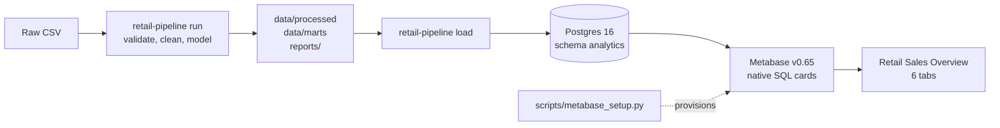

# Metabase dashboard

The dashboard runs on Linux with Docker, so it replaces the Power BI build on machines where
Power BI is not available. Metabase reads the pipeline outputs from a Postgres warehouse, and
every card is a native SQL question over the `analytics` schema. The page plan (six pages, same
reference values) follows [powerbi.md](powerbi.md).

## Quick start

Requirements: Docker with Compose, and `uv`.

```bash
make up          # start Postgres (port 5433) and Metabase (port 3000), wait until healthy
make run         # raw CSV -> validation -> star schema -> KPI marts (data/, reports/)
make load        # write the outputs into the `analytics` schema
make dashboard   # create the Metabase admin, connection, cards and dashboard (idempotent)
```

`make all` runs `run`, `load` and `dashboard` in sequence once the stack is up. The dashboard URL
is printed at the end of `make dashboard`: <http://localhost:3000/dashboard/2> on a fresh stack.

Credentials are in `.env` (copied from the committed `.env.example`). They are local-only, for the
throwaway containers on this machine.

## Architecture



Compose services (`docker-compose.yml`):

| Service | Image | Port (host) | Role |
|---|---|---|---|
| `warehouse` | `postgres:16-alpine` | 5433 | databases `retail` (data) and `metabase_app` (Metabase metadata) |
| `metabase` | `metabase/metabase:v0.65.6.3` | 3000 | dashboards, connected to `warehouse:5432` inside the compose network |

Tables in `analytics` (created by `retail-pipeline load`, primary and foreign keys set for joins):

- Star schema: `fact_sales` (one row per order), `dim_date`, `dim_customer`, `dim_product`,
  `dim_geography`.
- KPI marts: `kpi_summary`, `sales_by_product`, `sales_by_region`, `sales_by_region_total`,
  `sales_monthly`, `sales_yearly`, `sales_by_segment`, `sales_by_channel`,
  `order_status_breakdown`.
- `quality_report`: one row from `reports/quality_report.json`.

Revenue and profit use realised (Completed) orders only, through `fact_sales.is_realised`. Segment
and industry come from `fact_sales` (order level), never from `dim_customer`, which keeps only the
latest snapshot per customer.

## Logging in

Open <http://localhost:3000> and sign in with `MB_ADMIN_EMAIL` and `MB_ADMIN_PASSWORD` from `.env`.
The first `make dashboard` creates this admin account. The collection is **Retail Sales Pipeline**,
and the dashboard is **Retail Sales Overview**.

## Tabs and cards

Each tab answers one business question. Values below are the reference figures from
`data/marts/` after `make run`.

| Tab | Card | Business question |
|---|---|---|
| Overview | Total revenue, Gross profit, Gross margin %, Orders, Average order value, Customers | How are the headline KPIs doing? (131.58 M USD, 35.07 %, 78,054 orders) |
| Overview | Revenue by month | How does revenue move month to month? |
| Products | Revenue by product | Which products drive revenue? (Product_D first, 30.02 M) |
| Products | Gross margin % by product | Which products are the most profitable? |
| Products | Product table | Revenue, profit, units, margin and rank per product |
| Geography | Revenue by region | Share of revenue per region (APAC 42.92 %) |
| Geography | Revenue by country | Which countries generate the sales? |
| Geography | Region and country table | Drill-down from region to country |
| Trends | Revenue by year and YoY | Is revenue growing? (flat, 12.9 M to 13.4 M per year) |
| Trends | Revenue by month of year | Seasonality: average revenue per calendar month |
| Trends | Revenue by season | Revenue per season (Winter, Spring, Summer, Fall) |
| Customers | Revenue by segment | Which segments bring the most revenue? (SMB first, 45.37 M) |
| Customers | Gross margin % by segment | Which segments are the most profitable? (Startup first) |
| Customers | Revenue per customer by segment | Value of an average customer per segment |
| Customers | Revenue by channel | Sales per channel |
| Customers | NPS and churn by segment | Satisfaction and churn per segment (from `sales_by_segment`) |
| Data quality | Cancellation rate %, Refund rate % | Share of cancelled and refunded orders (all statuses) |
| Data quality | Valid rows % | Share of raw rows that passed validation (100 %) |
| Data quality | Order status breakdown | Orders per status |
| Data quality | Validation report | Rows total, valid, rejected, duration, errors by rule |

The layout uses a 24-column grid. Scalars are 4 by 3, charts 12 or 24 wide, tables 24 by 8.

## Refresh

When the raw CSV changes, or to rebuild after a code change:

```bash
make run && make load
```

Metabase reads the tables directly, so no republish is needed: reload the dashboard page. The
schema is re-synced when `make dashboard` runs again, which is safe to repeat. It recreates the
cards with the same names and replaces the dashboard layout in place (same dashboard id).

## Troubleshooting

- **`make up` fails with a port already in use**: something else holds 5433 or 3000. Stop it, or
  change the host port in `docker-compose.yml` (and `WAREHOUSE_PORT` in `.env` for 5433).
- **`retail-pipeline load` exits with code 3**: the warehouse is not reachable. Run `make up`, and
  check `WAREHOUSE_*` in `.env`.
- **`make dashboard` times out waiting for Metabase**: the first start takes one to two minutes.
  Check `docker compose ps` (the `metabase` service must be `healthy`) and
  `docker compose logs metabase`.
- **`make dashboard` cannot find the tables**: run `make load` first. The script waits up to three
  minutes for Metabase to sync the `analytics` schema.
- **A card shows an error after a change to the SQL**: the card SQL lives in
  `scripts/metabase_setup.py`. Edit it there and rerun `make dashboard`; the script prints a
  status per card and fails if one returns no rows.
- **Start from scratch**: `make nuke` removes the containers and the `pgdata` volume (warehouse
  data and Metabase state). Then run `make up && make all`.

## Screenshots

To add once the dashboard is reviewed (not yet captured):

- `docs/img/metabase-overview.png`: Overview tab
- `docs/img/metabase-products.png`: Products tab
- `docs/img/metabase-data-quality.png`: Data quality tab
