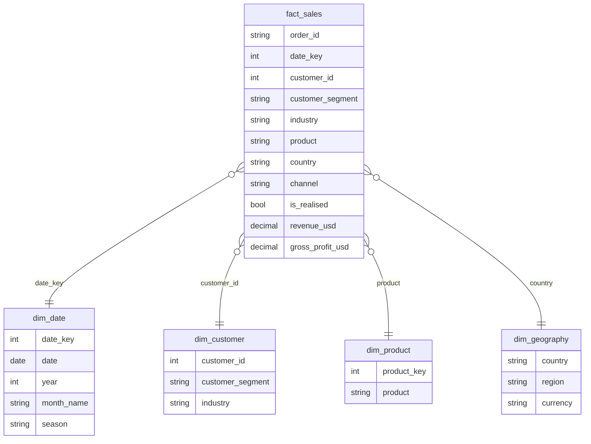

# Power BI dashboard guide

This guide rebuilds the sales dashboard by hand from the pipeline outputs. It covers the import,
the data model, the DAX measures, the six report pages and the reference values to check against.

## 1. Import

Generate the files first with `make run` (or `uv run retail-pipeline run`).

Import the star schema from `data/processed/` with **Get Data -> Text/CSV**, one query per table:

| Table | File | Role |
|---|---|---|
| `fact_sales` | `data/processed/fact_sales.csv` | One row per order (all statuses) |
| `dim_date` | `data/processed/dim_date.csv` | Calendar, one row per day |
| `dim_customer` | `data/processed/dim_customer.csv` | One row per customer (latest snapshot) |
| `dim_product` | `data/processed/dim_product.csv` | One row per product |
| `dim_geography` | `data/processed/dim_geography.csv` | One row per country, with region and currency |

`data/marts/` holds the same KPIs pre-aggregated (`kpi_summary.csv`, `sales_by_product.csv`,
`sales_monthly.csv`, ...). Use them for quick checks against the model or as a fallback if you
prefer not to build the model; the dashboard below is built on the star schema.

Quality figures come from `reports/quality_report.json` (**Get Data -> JSON**) and rejected rows
from `reports/rejected_rows.csv`.

### Power Query types

Set these column types after loading (Transform data):

- `date_key`: Whole number (Int64). Keep it as a key, never as a measure.
- `date` (dim_date): Date.
- `transaction_date` is not loaded; `dim_date` carries the date.
- Money columns (`revenue_usd`, `gross_profit_usd`, `net_profit_usd`, `revenue_local`,
  `tax_amount_usd`, `shipping_cost_usd`, `unit_price_usd`, `discount_amount_usd`): Decimal number.
- Flags (`is_realised`, `is_weekend`, `return_flag`, `is_repeat_customer`, `is_churned`,
  `discount_sensitive`): True/False. The CSV already writes `true` / `false`.
- `quantity`, `orders`, `support_tickets`, `days_to_delivery`: Whole number.
- `order_id`, `customer_id`, `product`, `country`, `customer_segment`, `industry`: Text (keys or
  slicers).

## 2. Data model



Relationships (Model view), all **many-to-one, single direction** (filter flows from the dimension
to `fact_sales`):

| From (many) | To (one) |
|---|---|
| `fact_sales[date_key]` | `dim_date[date_key]` |
| `fact_sales[customer_id]` | `dim_customer[customer_id]` |
| `fact_sales[product]` | `dim_product[product]` |
| `fact_sales[country]` | `dim_geography[country]` |

Mark `dim_date` as the date table: select `dim_date[date]`, then **Table tools -> Mark as date
table**.

### Important caveat: customer segment and industry

In the source data, `customer_segment` and `industry` change across orders for the same customer:
25,726 customers (of 43,223) have more than one segment, and 28,223 have more than one industry.
`dim_customer` keeps only the **latest** snapshot, so its values describe the most recent order,
not the whole history.

Therefore:

- Use `fact_sales[customer_segment]` and `fact_sales[industry]` for segment and industry slicers,
  bar charts and margins. These are the value of each order.
- Use `dim_customer` only for customer-level attributes such as `first_order_date`,
  `last_order_date`, `orders_count`, `clv_3yr_usd`, `churn_probability`.
- Do not connect a segment slicer on `dim_customer` to revenue: the result is wrong for customers
  whose segment changed.

## 3. DAX measures

Create a table named `_Measures` (**Home -> Enter data**, no rows, then delete the column) and put
every measure in it. Realised revenue uses only Completed orders (`is_realised = TRUE`); order
counts for cancellation and refund rates use all statuses.

```dax
Total Revenue =
CALCULATE(SUM(fact_sales[revenue_usd]), fact_sales[is_realised] = TRUE())
```

```dax
Total Gross Profit =
CALCULATE(SUM(fact_sales[gross_profit_usd]), fact_sales[is_realised] = TRUE())
```

```dax
Total Net Profit =
CALCULATE(SUM(fact_sales[net_profit_usd]), fact_sales[is_realised] = TRUE())
```

```dax
Gross Margin % =
DIVIDE([Total Gross Profit], [Total Revenue])
```
Format as Percentage.

```dax
Orders =
CALCULATE(DISTINCTCOUNT(fact_sales[order_id]), fact_sales[is_realised] = TRUE())
```

```dax
Units =
CALCULATE(SUM(fact_sales[quantity]), fact_sales[is_realised] = TRUE())
```

```dax
Customers =
CALCULATE(DISTINCTCOUNT(fact_sales[customer_id]), fact_sales[is_realised] = TRUE())
```

```dax
Average Order Value =
DIVIDE([Total Revenue], [Orders])
```

```dax
Revenue LY =
CALCULATE([Total Revenue], SAMEPERIODLASTYEAR(dim_date[date]))
```

```dax
Revenue YoY % =
DIVIDE([Total Revenue] - [Revenue LY], [Revenue LY])
```
Format as Percentage.

```dax
Revenue MTD =
CALCULATE([Total Revenue], DATESMTD(dim_date[date]))
```

```dax
Revenue YTD =
TOTALYTD([Total Revenue], dim_date[date])
```

```dax
Rolling 3M Revenue =
CALCULATE(
    [Total Revenue],
    DATESINPERIOD(dim_date[date], MAX(dim_date[date]), -3, MONTH)
)
```

```dax
Cancellation Rate % =
DIVIDE(
    CALCULATE(COUNTROWS(fact_sales), fact_sales[order_status] = "Cancelled"),
    COUNTROWS(fact_sales)
)
```
Over all orders (not only realised). Format as Percentage.

```dax
Refund Rate % =
DIVIDE(
    CALCULATE(COUNTROWS(fact_sales), fact_sales[order_status] = "Refunded"),
    COUNTROWS(fact_sales)
)
```
Over all orders (not only realised). Format as Percentage.

```dax
Revenue Rank Product =
RANKX(ALL(dim_product), [Total Revenue])
```
Use in the products table; rank 1 is the highest revenue.

```dax
Revenue Share % =
DIVIDE([Total Revenue], CALCULATE([Total Revenue], ALL(fact_sales)))
```
Share of the total for the current filter context. Format as Percentage.

## 4. Report pages

Each page answers one business question. Slicers year, region and channel can be placed on
page 1 and synced to the other pages (**View -> Sync slicers**).

### Page 1: Overview

- Cards (KPI): `Total Revenue`, `Total Gross Profit`, `Gross Margin %`, `Orders`,
  `Average Order Value`, `Customers`.
- Line chart: x = `dim_date[year_month]`, y = `Total Revenue`.
- Slicers: `dim_date[year]`, `dim_geography[region]`, `fact_sales[channel]`.

### Page 2: Products

- Bar chart: y = `dim_product[product]`, x = `Total Revenue`, sorted descending.
- Scatter chart: x = `Total Revenue`, y = `Gross Margin %`, details = `dim_product[product]`.
- Table: `dim_product[product]`, `Total Revenue`, `Gross Margin %`, `Units`, `Revenue Rank Product`.

### Page 3: Geography

- Filled map (or map): location = `dim_geography[country]`, bubble/colour = `Total Revenue`.
- Bar chart: y = `dim_geography[region]`, x = `Total Revenue`, plus `Revenue Share %`.
- Matrix: rows = `dim_geography[region]` then `dim_geography[country]`, values = `Total Revenue`,
  `Gross Margin %`, `Orders`.

### Page 4: Trends

- Line chart: x = `dim_date[year_month]`, y = `Total Revenue` and `Revenue LY`.
- Column chart: x = `dim_date[year]`, y = `Total Revenue`, with `Revenue YoY %` as a tooltip.
- Seasonality: column chart x = `dim_date[month_name]` (sort by `dim_date[month]`), y = `Total
  Revenue`; a second view on `dim_date[season]`.
- Rolling line: `Rolling 3M Revenue` by `dim_date[year_month]`.

### Page 5: Customers

- Bar chart: y = `fact_sales[customer_segment]`, x = `Total Revenue`, plus `Gross Margin %` as a
  second visual.
- Card or bar: `Total Revenue / Customers` by segment (revenue per customer), using
  `fact_sales[customer_segment]`.
- NPS and churn by segment: `fact_sales` does not carry `nps_score` or `churn_probability`, so
  import `data/marts/sales_by_segment.csv` as a separate table (no relationship needed) and show
  its `avg_nps` and `avg_churn_probability` columns against `customer_segment` in a table. These
  averages are computed on order rows in the pipeline, consistent with the caveat in section 2.

### Page 6: Data quality

- Cards from `quality_report.json`: `valid_pct`, `rejected_rows`, `total_rows`.
- Donut chart of `order_status` from `fact_sales` (count of rows by `order_status`) to show the
  status breakdown across all orders.
- Table from `rejected_rows.csv` (empty in the current run).

## 5. Reference values

Check the dashboard against these figures. They come from `data/marts/` after `make run`
(revenue and profit use realised, i.e. Completed, orders; rates use all 100,000 orders).

| Measure | Value | Source |
|---|---|---|
| Total revenue | 131,577,388.66 USD (about 131.58 M) | `kpi_summary.csv` |
| Total gross profit | 46,141,009.72 USD (about 46.14 M) | `kpi_summary.csv` |
| Gross margin | 35.07 % | `kpi_summary.csv` |
| Orders (realised) | 78,054 | `kpi_summary.csv` |
| Average order value | 1,685.72 USD | `kpi_summary.csv` |
| Customers (realised) | 39,480 | `kpi_summary.csv` |
| Units | 312,731 | `kpi_summary.csv` |
| Cancellation rate | 5.97 % | `kpi_summary.csv` |
| Refund rate | 7.08 % | `kpi_summary.csv` |
| Top product by revenue | Product_D, 30.02 M USD (22.81 %) | `sales_by_product.csv` |
| 2nd / 3rd product | Product_H 24.44 M, Product_J 18.12 M | `sales_by_product.csv` |
| Revenue by region | APAC 56.48 M (42.92 %), Americas 43.89 M (33.36 %), EMEA 31.21 M (23.72 %) | `sales_by_region_total.csv` |
| Best segment by revenue | SMB, 45.37 M USD | `sales_by_segment.csv` |
| Best segment by margin | Startup, 35.23 % | `sales_by_segment.csv` |
| Best year by revenue | 2016, 13.38 M USD | `sales_yearly.csv` |

## 6. Refresh

1. Run `make run` (or `uv run retail-pipeline run`) to regenerate `data/processed/`,
   `data/marts/` and `reports/`.
2. In Power BI Desktop, click **Home -> Refresh**. Power BI reloads the CSV files from the same
   paths; if you moved the project, update the source paths in **Transform data -> Source**.
